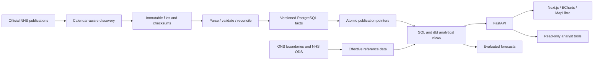

# NHS Pulse

**Published hospital statistics, with the evidence behind every number.**

NHS Pulse connects NHS England A&E activity, diagnostic waiting times and quarterly bed capacity in an analytical workspace. Each measure carries its reporting period, official source, publication version and ingestion lineage. The application is independent of the NHS and uses public aggregate statistics only.

## Product

| Workspace | Purpose |
|---|---|
| National Overview | Attendance, four-hour outcomes, emergency admissions and a clearly dated capacity reference |
| Emergency Care | Department and booked-appointment filters, provider spread and decision-to-admit waits |
| Capacity & Beds | Overnight/day-only quarterly returns, bed-day denominators and consultant specialties |
| Trust Explorer | Search, sorting, provider profiles and comparison of up to three organisations |
| Geographic Intelligence | Official ONS region/ICB boundaries, effective provider assignments and an accessible comparison table |
| Forecasting & Trends | Seasonal benchmark, rolling-origin evaluation, registry and empirical uncertainty intervals |
| AI Healthcare Analyst | Bounded read-only tools, private visitor notebooks and release-linked evidence |
| Data Operations | Source calendar, checksums, validation, revisions, quarantine and publication audit |

## Engineering decisions

**Publication frequency defines the system.** Monthly A&E and diagnostics observations coexist with quarterly KH03 returns. A page reload reads published analytical views; it does not claim a new upstream release or trigger collection. The official publication calendar governs expected dates, including exceptions and London daylight-saving changes.

**Raw evidence is immutable.** Downloaded files are retained by SHA-256 in object-style local storage and PostgreSQL. Parsing, validation and reconciliation precede a transactional publication-pointer switch. Identical files produce a no-change event. New checksums retain the previous release and revision link. Failed validation preserves the last valid analytical version.

**Denominators and scope are explicit.** A&E headline totals include booked appointments where published. Decision-to-admit waits are distinct from arrival-to-departure performance. KH03 averages are converted to quarterly bed-days using the actual number of calendar days. Diagnostic provider and commissioner projections are non-additive; NONC activity is retained in raw evidence and excluded from the NHS-commissioned analytical scope.

**Geography is versioned.** The map uses official ONS polygons without a commercial tile dependency. Provider assignments have effective dates. Headquarters are never represented as catchments, and historical months without an applicable crosswalk remain unavailable.

**Prediction follows evaluation.** England aggregate attendance forecasts compare a seasonal-naïve baseline with damped seasonal ETS using expanding rolling origins. MAE and WAPE determine selection. Prediction intervals use horizon-specific held-out errors, and sparse horizons are withheld. These are aggregate statistical forecasts, not clinical or live-bed predictions.

**The analyst cannot submit SQL.** A configurable server-side model uses nine typed, bounded tools. Parameterised queries, tool-call limits, numerical grounding checks, per-visitor allowances and a shared daily budget constrain investigations. Conversations and evidence are isolated by signed visitor sessions. Operational mutation requires a separate administrator key.

## Architecture



Python 3.12 · PostgreSQL 18 / PostGIS · SQLAlchemy 2 · dbt Core · FastAPI · APScheduler · Next.js / TypeScript · TanStack Query · ECharts · MapLibre.

## Run locally

Install Python 3.12 with uv, Node 24 and Docker Desktop. Copy `.env.example` to `.env` and set unique database passwords, session and administrator secrets. Keep the reader, worker and migration URLs aligned with those role credentials.

```sh
uv sync --frozen
npm --prefix apps/web ci
docker compose up --build -d
docker compose run --rm worker uv run --no-sync python -m tools.seed_sources
docker compose run --rm worker uv run --no-sync python -m pipelines.orchestration.collect --source ae --backfill 36
docker compose run --rm worker uv run --no-sync python -m pipelines.orchestration.collect --source diagnostics --backfill 12
docker compose run --rm worker uv run --no-sync python -m pipelines.orchestration.collect --source beds_overnight --backfill 4
docker compose run --rm worker uv run --no-sync python -m pipelines.orchestration.collect --source beds_day --backfill 4
docker compose run --rm worker uv run --no-sync python -m pipelines.discovery.geography
docker compose run --rm worker uv run --no-sync python -m services.forecasting.train
```

Web: `http://127.0.0.1:3020/overview` · API documentation: `http://127.0.0.1:8020/docs`.

On Windows without a running Docker engine, `tools/bootstrap_database.py` provisions a separate native PostgreSQL cluster on port 5546 when official PostgreSQL binaries are available. `tools/install_spatial_runtime.py` installs the official PostGIS bundle into that isolated runtime. Then run `tools.migrate`, `alembic upgrade head`, `tools.seed_sources`, the collection commands above, and the API/web commands in the Makefile.

The analyst is disabled when `LLM_API_KEY` is empty. A configured provider receives the question and bounded public aggregate evidence; keys remain server-side. Default limits are six investigations per visitor and forty overall per day. This is an abuse limit, not a currency spending guarantee.

## Verification

```sh
uv run ruff check apps/api services pipelines tools tests --select E4,E7,E9,F
uv run pytest -q
# Bash; in PowerShell use $env:RUN_DATABASE_TESTS='1'
RUN_DATABASE_TESTS=1 uv run pytest -q
uv run python -m tools.dbt_build
npm --prefix apps/web run build
npm --prefix apps/web run typecheck
uv run python -m tools.smoke_api
```

Integration acceptance is restricted to the separate `nhs_pulse_test` database. Corrected fixtures and injected failures never enter the application database. Captured official fixtures and their source/checksum records are in `tests/fixtures`.

## Deployment

The portable deployment consists of PostgreSQL/PostGIS, a FastAPI service and a Next.js frontend. `infra/render.yaml` describes a free web service; collection can run through GitHub Actions instead of a paid continuous worker. The hourly workflow performs source-specific due checks and does not ingest unchanged files. It remains inactive until its database secrets are connected. Vercel needs `apps/web` as its root directory and the backend origin as `API_INTERNAL_URL` at build time.

Free services may sleep and scheduled workflows can be delayed. Data Operations reports the actual check/ingestion record rather than masking these conditions. See [source contracts](docs/source-contracts.md), [operations](docs/operations.md) and [verification status](docs/implementation-status.md).

## Attribution

NHS England statistical publications: Open Government Licence v3.0. ONS boundaries contain OS and ONS data © Crown copyright and database right. Source URLs and versions remain attached to records. No NHS logo, endorsement, patient-level data, diagnosis or clinical advice is implied.

Designed and engineered by **Victor Okeke** · [Portfolio](https://victorokeke.co.uk).
